# JML Automation: Joiner, Mover, Leaver on ServiceNow

A ServiceNow scoped application that automates the employee access lifecycle. This repository documents the build, the design decisions and the test evidence. It is the final project for the RiseUp with ServiceNow programme, built by Kunmi Adejumo as part of a move into Identity and Access Management (IAM).

**Status:** Joiner flow and task completion flow built and tested. Mover, Leaver and reporting are in progress (see the [roadmap](#roadmap)).

## The problem

When access is managed by hand, three things go wrong:

- **Joiners** wait days for accounts and equipment because requests are passed around by email.
- **Movers** collect permissions from old roles that nobody removes, known as privilege creep.
- **Leavers** keep active accounts after they have left, which is a common audit finding and a real security risk.

## The solution

One request starts a repeatable, approved and auditable process. The role a person is hired into decides their standard access through a **Role Template**. Anything beyond the template needs manager approval.

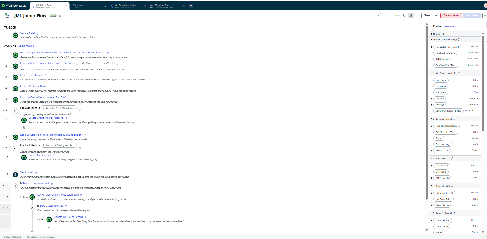

## What is built so far

### 1. Data model
| Table | Purpose |
|---|---|
| **Role Template** (custom) | Defines standard access per job role: department, job title, default group, default catalog items |
| **JML Event** (custom) | One audit record per joiner, mover or leaver: number, type, state, employee, manager, effective date, linked request |
| Request, Requested Item, Catalog Task, User, Group, Group Member | Out-of-the-box tables reused for approvals and fulfilment |

Reusing platform tables kept the build realistic and avoided rebuilding approvals and task handling.

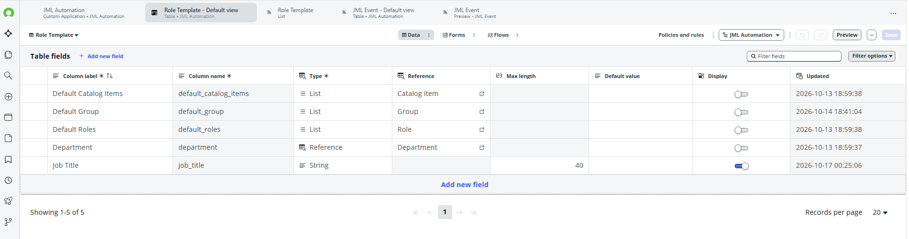
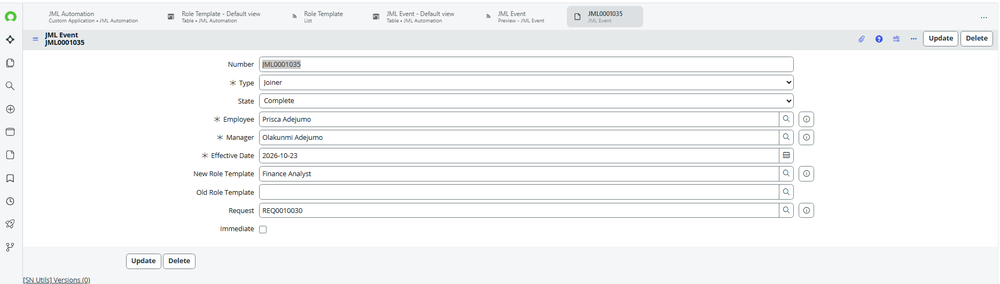

### 2. New Starter Request (catalog item)
A Service Catalog item collects first name, last name, start date, job title (a reference to Role Template), manager and any additional access needed. A catalog client script blocks start dates in the past.

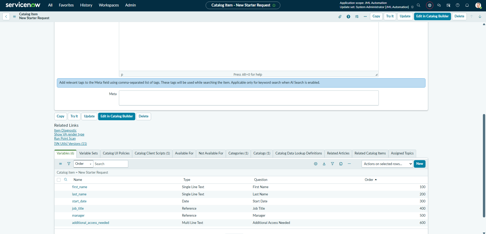

### 3. JML Joiner Flow
Triggered by the catalog item. In order, it:

1. Reads the request variables.
2. Looks up the Role Template matching the job title.
3. Creates the user, with a lowercase User ID and email built from the name.
4. Creates a JML Event in the **In Progress** state.
5. Looks up the template's default group and adds the user to it. Roles are inherited through the group.
6. Looks up the template's default catalog items and raises one fulfilment task per item for the fulfiller group.
7. Sends a notification to the manager.
8. If additional access was requested, asks the manager for approval. A rejection sets the event to **Partially Complete**.

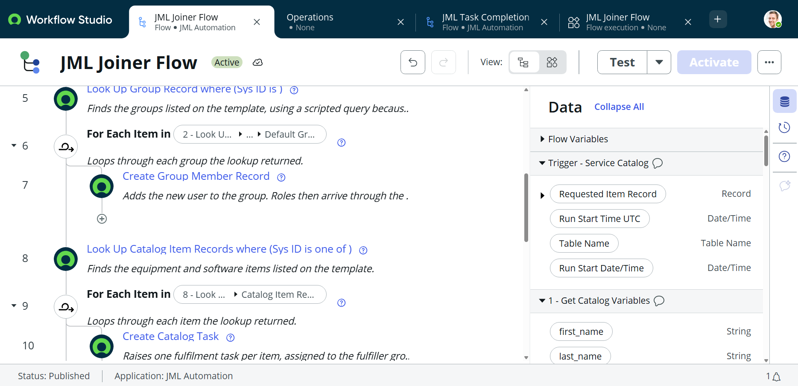
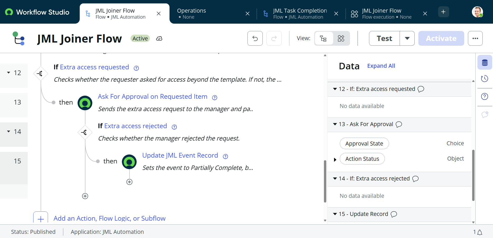

### 4. JML Task Completion flow
A second flow triggers when a catalog task is closed complete. It checks whether any tasks for the same request are still open. When none remain, it sets the JML Event to **Complete**.

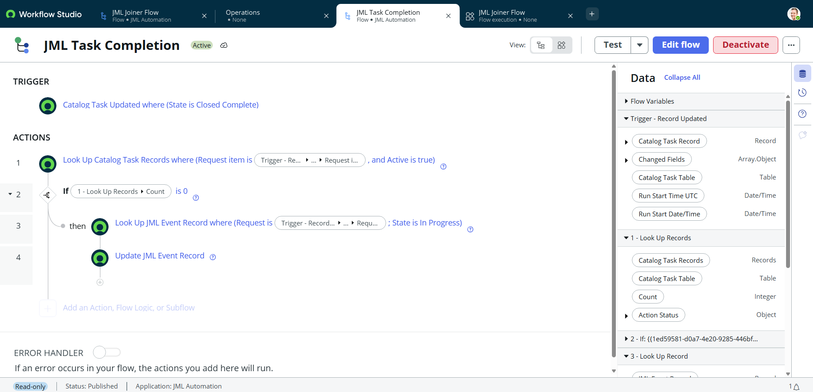

## Design decisions

- **Access through groups, not direct role grants.** Users get roles by joining a group, so access follows group membership. This is standard IAM practice and is easier to review and revoke than person-by-person grants.
- **Standard access is not held back by approvals.** Template access is granted immediately and only the extra request waits for the manager. A rejection therefore leaves the event **Partially Complete**, not **Cancelled**, because the joiner itself is not undone.
- **Fulfilment tasks do not pause the main flow.** The flow does not wait on each task. A separate flow closes the event when the last task finishes, so the approval and notification steps are never blocked by equipment tasks.
- **The flow runs as the system user.** Creating users and memberships does not depend on who submitted the request, so access to the app is controlled by roles and catalog availability instead.
- **Every action leaves a record.** The JML Event, approval records and flow execution history together give an audit trail of who requested what and what the system did.

## Testing

| # | Scenario | Expected result | Evidence | Result |
|---|---|---|---|---|
| 1 | Standard joiner, no extra access | User, group membership, event (In Progress), tasks and manager notification created; approval branch not run | [Execution](docs/screenshots/13-s1-execution.png), [User groups](docs/screenshots/14-s1-user-groups.png), [Tasks](docs/screenshots/16-s1-tasks.png) | Passed |
| 2 | Close all fulfilment tasks | Event stays In Progress until the last task closes, then moves to Complete | [One task closed](docs/screenshots/19a-s2-event-in-progress.png), [Both closed](docs/screenshots/19-s2-event-complete.png) | Passed |
| 3 | Extra access approved | Flow pauses at approval, resumes on approval, event stays In Progress until tasks close | [Waiting](docs/screenshots/20-s3-approval-waiting.png), [Pending approval](docs/screenshots/20b-s3-approval-pending.png), [Approved](docs/screenshots/21-s3-approved.png) | Passed |
| 4 | Extra access rejected | Rejection branch runs and the event becomes Partially Complete | [Execution](docs/screenshots/22-s4-rejected-execution.png), [Event](docs/screenshots/23-s4-event-partial.png) | Passed |

### Scenario 1 evidence: access granted through the group

The new user was added to the Finance Team group by the flow, and the group's roles arrived through inheritance.

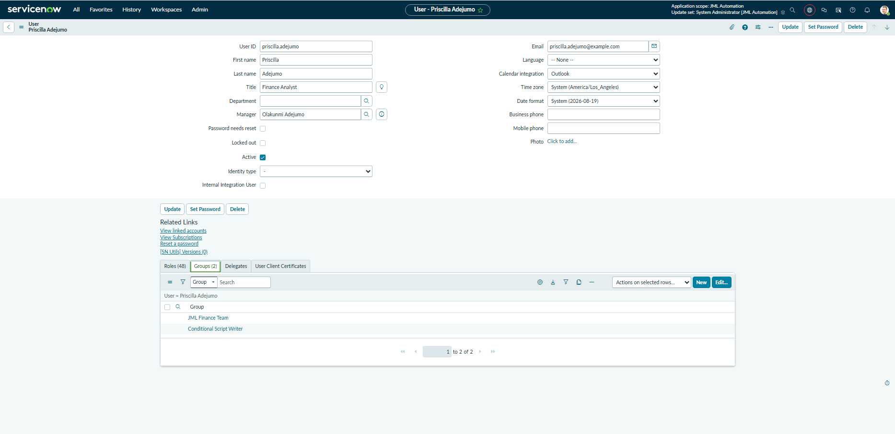
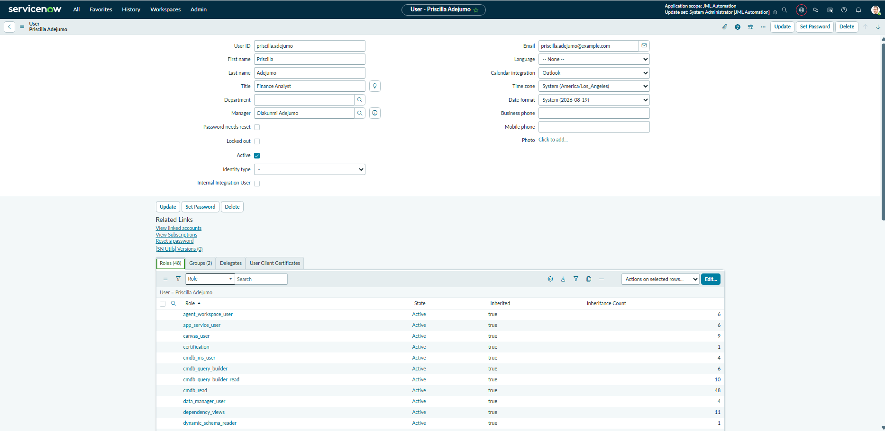

### Scenario 2 evidence: the event completes only when the last task closes

With one of two fulfilment tasks closed, the event correctly stays In Progress.

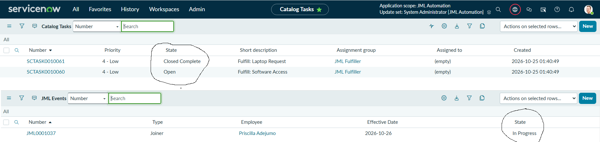

Once the second task is closed, the task completion flow sets the event to Complete.

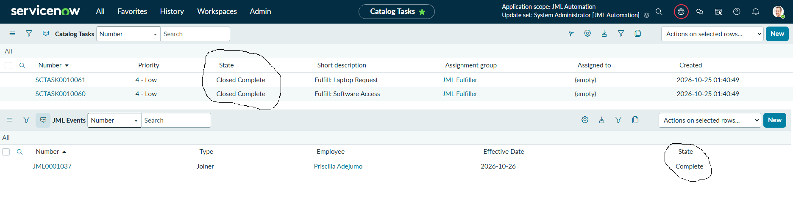

### Scenario 3 evidence: extra access approved

With extra access requested, the flow granted standard access first, then paused at the manager approval.

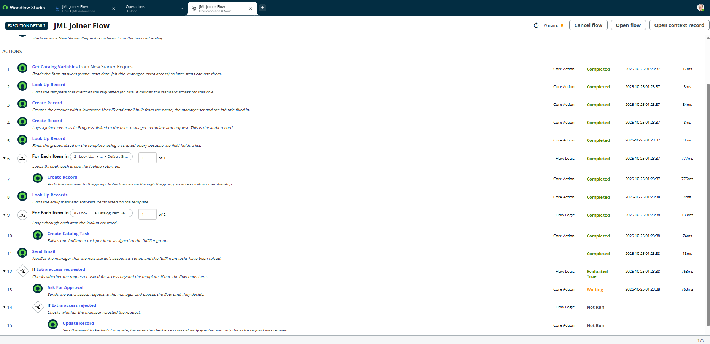

The pending approval was assigned to the manager.

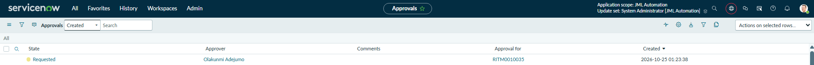

After the manager approved, the same run resumed and completed. The event stayed In Progress until the fulfilment tasks were closed.

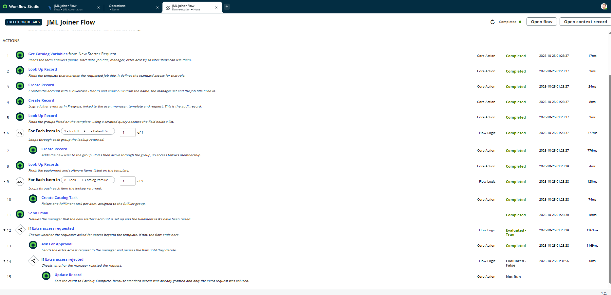

### Scenario 4 evidence: extra access rejected

When the manager rejected the extra access request, the rejection branch ran and the Update step completed.

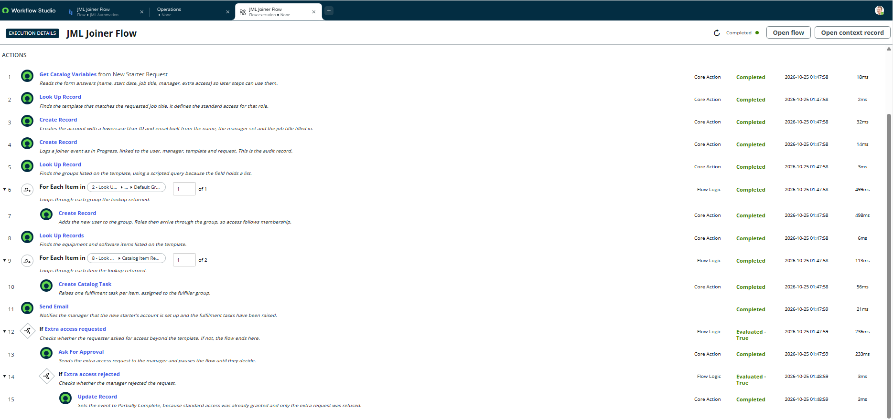

The event was set to Partially Complete, because the standard access had already been granted and only the extra request was refused.

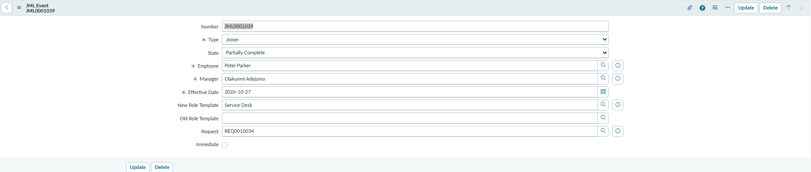

## Problems solved along the way

| Problem | Cause | Fix |
|---|---|---|
| Template lookup found nothing | The Reference variable passed the display text, but the condition matched on Sys ID | Matched on the Job Title field instead |
| Catalog variables arrived empty | Test runs used a request item that held no variable values | Tested with real catalog orders |
| List fields rejected in a condition | A Glide List field cannot be dropped into an "is one of" condition | Used a scripted encoded query (`sys_idIN` plus the list value) |
| Flow never started from a real order | The catalog item was not linked to the flow | Set the flow on the item's Process Engine tab |
| Role table not available in the flow | Platform table not exposed to the scoped app | Granted roles through group membership instead |
| Approval step ran on every outcome | The update step was outside the rejection branch | Moved it under the branch so it only runs on rejection |
| Event completed too early | The flow paused on each task | Removed the wait and closed the event from a separate flow |

## Roadmap

- [ ] **Mover flow:** grant the new role's access, then create a time-boxed task for the manager to confirm removal of the old access
- [ ] **Leaver flow:** revoke group membership, deactivate the account and raise asset recovery tasks, with an urgent path for immediate departures
- [ ] **Orphaned account check:** daily scheduled flow that flags inactive users who still hold group memberships
- [ ] **Access controls:** restrict who can create or change templates and events, and enforce separation of duties on approvals
- [ ] **Dashboard:** open reviews, task completion times and overdue items
- [ ] **Integration design:** diagram showing how the flows would connect to Active Directory or Entra through a MID Server

## Skills demonstrated

ServiceNow scoped application design, Service Catalog, Flow Designer, data modelling, approvals, role and group based access, joiner-mover-leaver governance, testing against defined scenarios, and troubleshooting through flow execution logs.

## Notes

All users, names and email addresses in this project are test data on a ServiceNow Personal Developer Instance. No real personal data or credentials are stored in this repository.
